<div align="center">

# platen

**Short notes. Real keys. No going back.**

A typewriter for your phone and your browser: one sheet, 3,000 characters, real CC0 typewriter
sounds, and no undo. Available as an **Android app (APK)** and as a **web app** (plain HTML/CSS/JS)
that look and work the same.

[English](#english) · [فارسی](#فارسی)

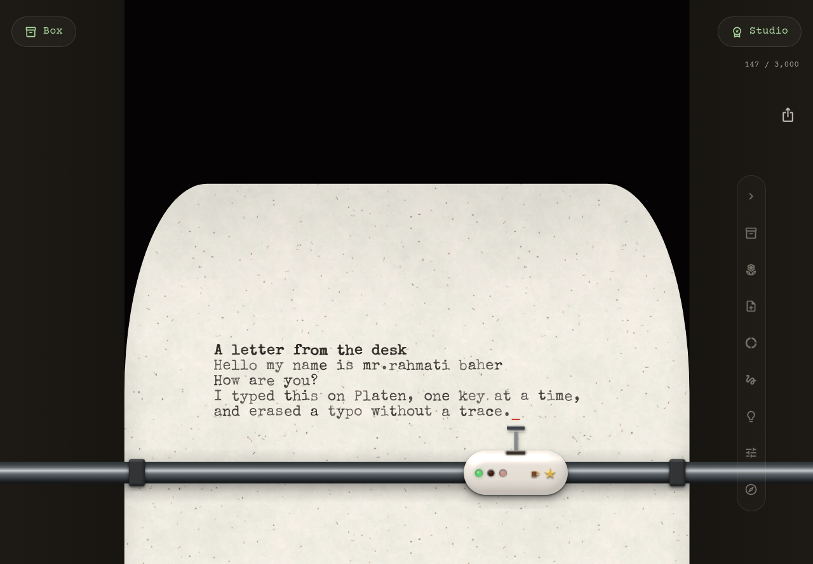

</div>

## Languages & tech stack · زبان‌ها و تکنولوژی‌ها

| | Android app (`android/`) | Web app (`web/`) |
|---|---|---|
| Main language · زبان اصلی | **Kotlin** | **JavaScript** (ES modules, no framework) |
| UI · رابط کاربری | Jetpack Compose + Material 3 | **HTML5** + **CSS3** + Canvas 2D |
| Build · ساخت | Gradle (Kotlin DSL, `.kts`) | None, static files · بدون نیاز به ساخت |
| Config/resources · تنظیمات و منابع | XML (`AndroidManifest.xml`, `res/`) | JSON (`manifest.webmanifest`, `package.json`) |
| Storage · ذخیره‌سازی | Room (SQLite) + DataStore | `localStorage` |
| Sound · صدا | Android SoundPool | Web Audio API |
| Tests · تست | JUnit + Robolectric (165 tests) | `node --test` (52 tests) |
| Tooling scripts · اسکریپت‌های کمکی | Python (sound processing, asset rendering) | YAML (GitHub Actions → Pages) |

## Downloads · فایل‌های zip

| File | What's inside · محتوا | When to use · کاربرد |
|---|---|---|
| `platen-repo.zip` | The **whole repository**: `android/` source + `web/` source + README, CHANGELOG, LICENSE, screenshots, GitHub Actions workflow · کل مخزن: سورس اندروید و وب، مستندات، اسکرین‌شات‌ها و workflow | Push to GitHub or build the APK yourself · برای گذاشتن روی گیت‌هاب یا ساختن APK |
| `platen-web.zip` | **Only the web app** (`index.html`, `css/`, `js/`, `assets/`, tests), ready to serve · فقط نسخه‌ی وب، آماده‌ی اجرا | Upload to any static host or open locally · برای آپلود روی هر هاست یا اجرای مستقیم |
| `Platen-3.2.apk` | The signed, installable Android app · اپ اندروید امضاشده | Install on a phone · برای نصب روی گوشی |

---

## English

### Contents
- [What is Platen?](#what-is-platen)
- [Features](#features)
- [Screenshots](#screenshots)
- [Repository layout](#repository-layout)
- [Android app](#android-app)
- [Web app](#web-app)
- [Morse mode](#morse-mode)
- [Keyboard shortcuts and gestures](#keyboard-shortcuts-and-gestures)
- [Credits & licences](#credits--licences)
- [Disclaimer](#disclaimer)

### What is Platen?
Platen turns writing back into typing. Every key strikes the paper with a real typewriter sound,
the carriage steps along the rod, and the bell rings near the margin. There is no cursor to move,
no selection, and no undo. You can erase the last letters with Backspace (or switch to
the classic overstrike ■), and when the sheet is full (3,000 characters) the note is done.
Notes are kept in your **Box**.

The Android app (Kotlin + Jetpack Compose) and the web app (vanilla JavaScript + Canvas 2D)
share the same design, the same assets and the same engine rules. The web engine is a faithful
port of the Kotlin domain code and is covered by tests that mirror the Kotlin tests.

### Features
- **The stage**: an arched sheet over a drum, a steel rod with rubber stops, a carriage with three LEDs
  (ready, strike and margin), a T-lever, and enamel **charms**.
- **Strike choreography**: the lever rises and strikes, the letter inks at the moment of impact, the
  carriage steps after the hit and Return bounces. The caret blinks only while you're idle.
- **Ink**: Special Elite typeface, with per-glyph variation in weight, offset and rotation that
  stays stable for each note.
- **Sounds**: real CC0 recordings (keys, space, backspace, carriage return, three bells, jam),
  randomised by ±4 % in pitch and ±10 % in volume per strike, and synced to the impact.
- **Correction**: *Backspace erases* (on by default, works across line breaks), or the classic
  overstrike that types ■ over the letter.
- **Title**: the first line of a note is its title. It's typed in bold and used in the Box and in exported file names.
- **Morse mode**: two-way translator with a reference chart (see [Morse mode](#morse-mode)).
- **Night lamp**: a desk lamp over the carriage, with sliders for warmth, intensity and beam width.
- **Themes**: Cream, Mint, Charcoal and Garden paper and machine.
- **Writing prompts**: 120 first lines ("Need a first line?").
- **Box**: all notes with title, preview, date and character count. The free plan allows three notes.
- **Studio**: unlimited notes plus PDF export. It's a local demo unlock, with no payments in either version.
- **Export**: Image (4:5, 1080×1350), Story (9:16, 1080×1920) and PDF (A4, US Letter, A5).
- **Layouts**: landscape with a vertical toolbar on the right; portrait with a cream pill under the rod.
- **Languages**: any script your keyboard can type, including Persian/Arabic (right-to-left), emoji and combining marks.

### Screenshots

| Android 3.2 | Web |
|---|---|
| 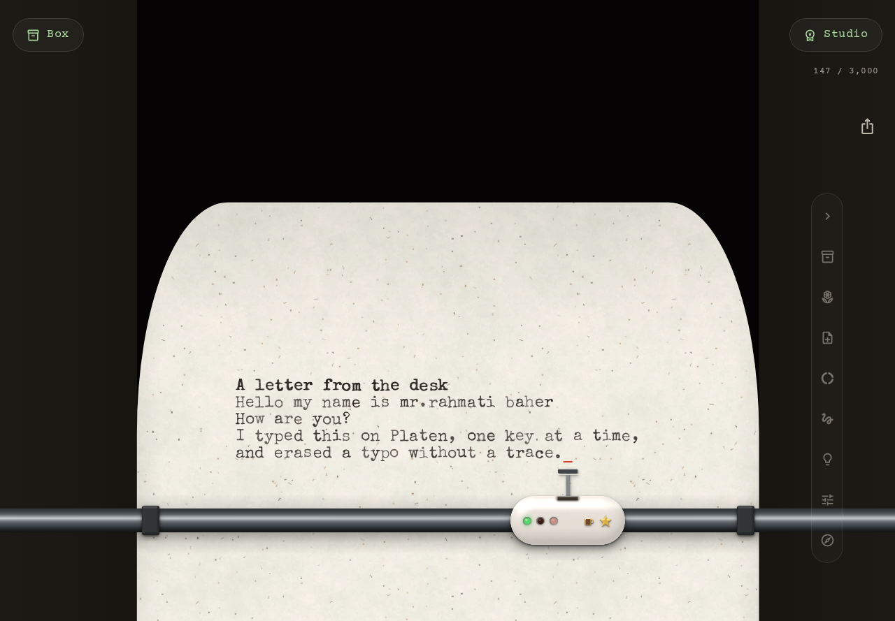 |  |
| 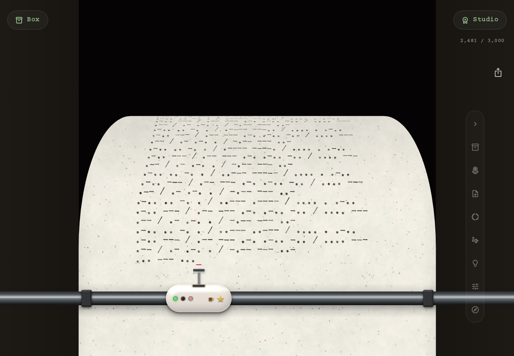 | 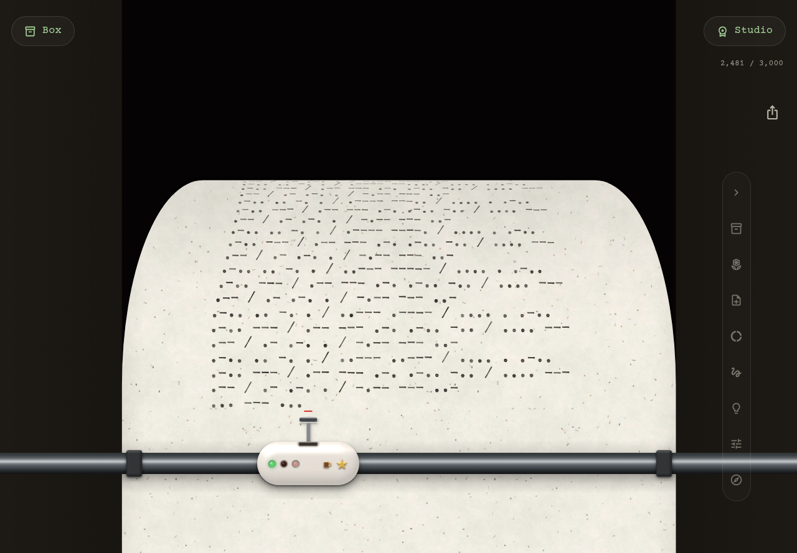 |
|  | 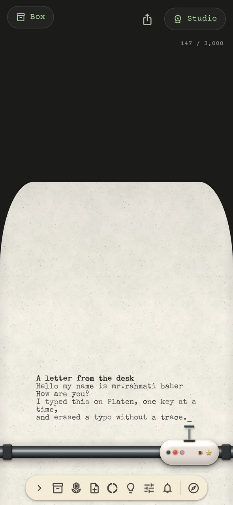 |

More from the web version:

| Morse session | Night lamp | Export |
|---|---|---|
| 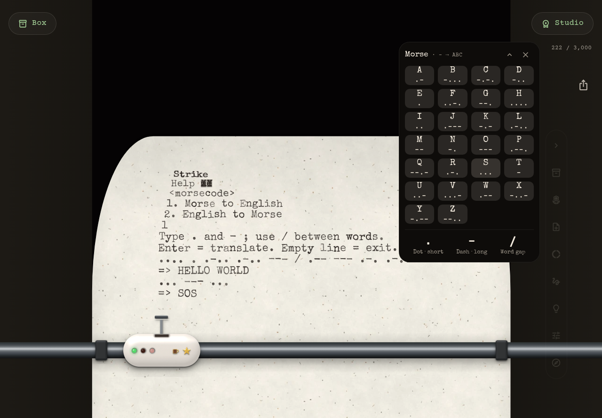 | 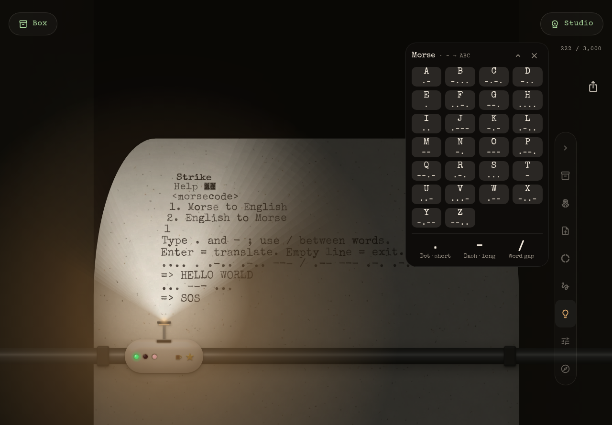 | 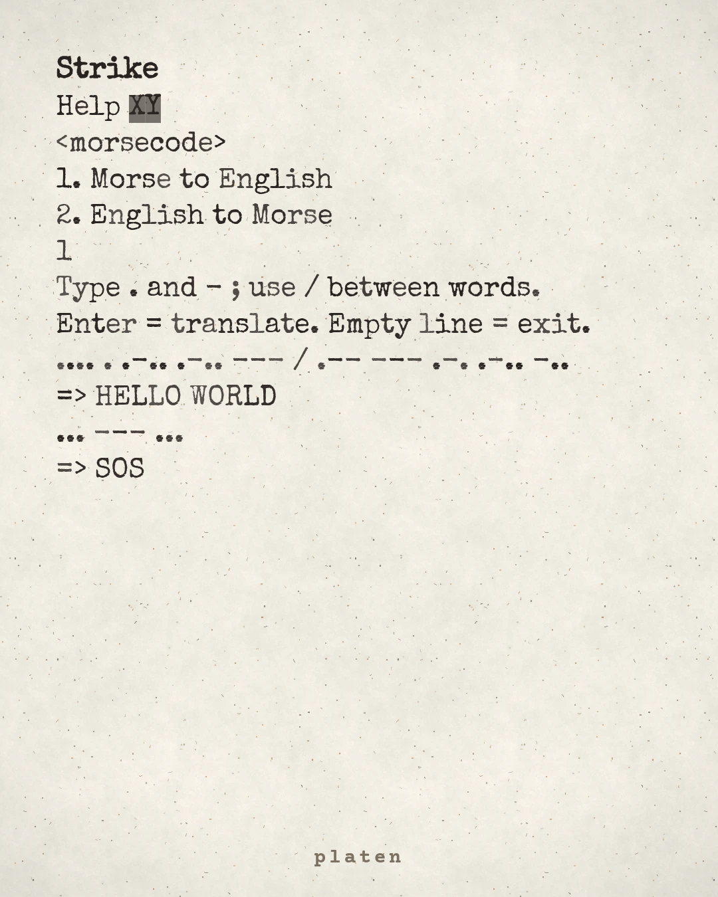 |
| **Box** | **Charcoal theme** | **Phone + Morse chart** |
| 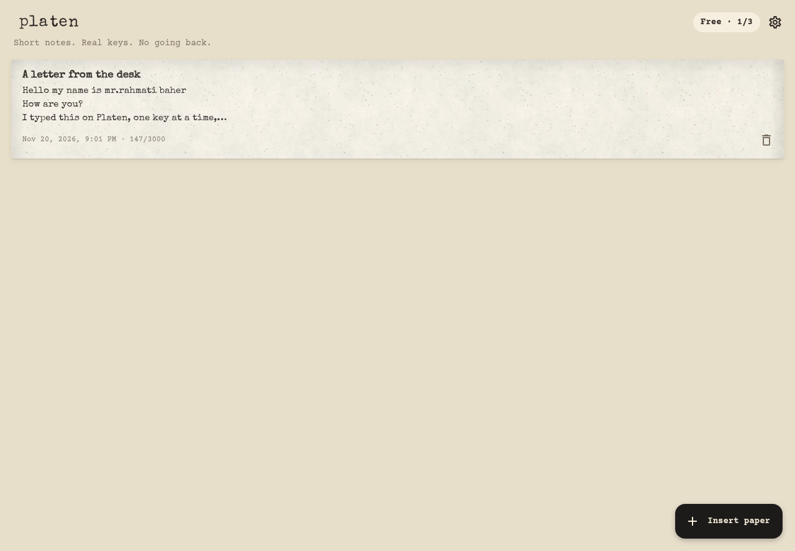 | 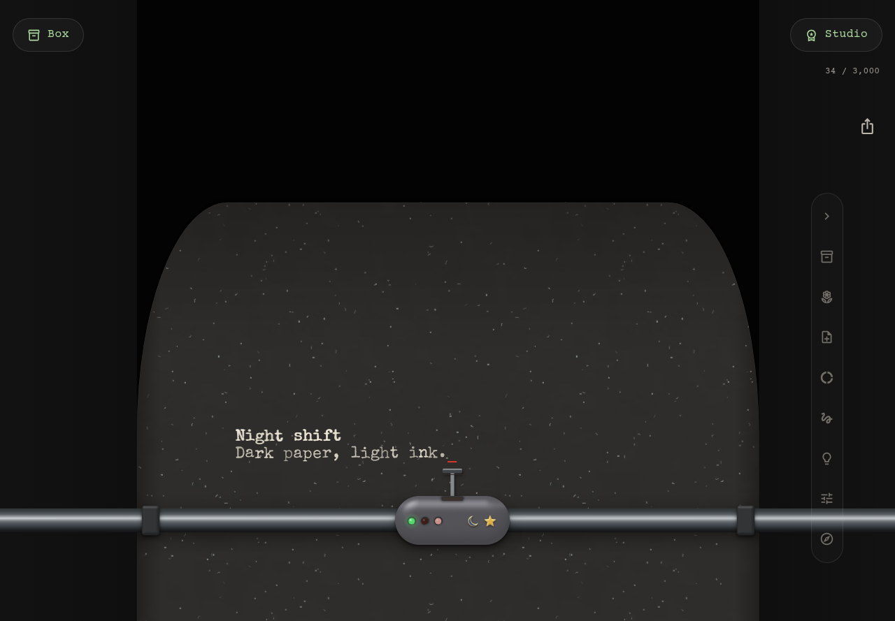 | 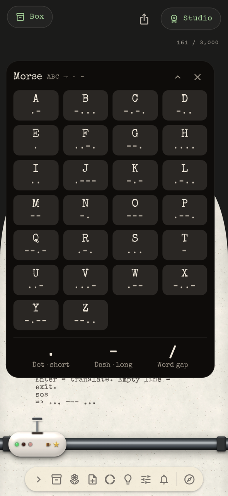 |

Side-by-side comparisons (same note and seed, rendered by each platform) are in
[`docs/screenshots/compare_*.png`](docs/screenshots).

### Repository layout
```
.
├── android/                 Android app (Gradle, Kotlin, Jetpack Compose)
│   ├── app/src/main/java/com/mahdi/platen/
│   │   ├── domain/          engine: TypewriterEngine, Glyph, SheetLayout, Morse, Strike, …
│   │   ├── data/            Room database, repository, DataStore settings
│   │   ├── audio/           SoundManager (SoundPool)
│   │   ├── export/          image / PDF export
│   │   └── ui/              Compose screens: editor, stage, lamp, notes, settings, studio
│   ├── app/src/test/        165 JVM tests (Robolectric + Compose UI tests)
│   ├── scripts/             asset and sound processing scripts (Python)
│   └── keystore.properties.example
├── web/                     Web app (no build step)
│   ├── index.html, manifest.webmanifest
│   ├── css/app.css
│   ├── js/engine/           port of the Kotlin domain layer (pure, testable in Node)
│   ├── js/stage/            canvas stage, geometry, Compose-like animation
│   ├── js/ui/               editor screen and DOM helpers
│   ├── js/app.js, audio.js, store.js, export.js, palette.js
│   ├── assets/              fonts, images, sounds, icons (same assets as Android)
│   └── tests/               node --test suites
├── docs/screenshots/
└── .github/workflows/pages.yml   deploys web/ to GitHub Pages
```

---

### Android app

#### Download
APK files are **not** committed to git. Download `Platen-3.2.apk` from the
[**Releases**](../../releases) page of this repository.

#### Install the APK
1. Copy the APK to your phone (or download it there).
2. Open it; when Android asks, allow *Install unknown apps* for your browser or file manager.
3. Tap **Install**. Requires Android 8.0 (API 26) or newer.

With a computer: `adb install -r Platen-3.2.apk`.

#### Requirements to build
- JDK 17
- Android SDK with platform 34 (install it with Android Studio, or set `ANDROID_HOME` / `sdk.dir` in `android/local.properties`)
- Gradle 8.7 (the wrapper `./gradlew` downloads it)
- Android Gradle Plugin 8.5.2, Kotlin 1.9.24

#### Build
```bash
cd android
./gradlew assembleDebug          # app/build/outputs/apk/debug/app-debug.apk
./gradlew assembleRelease        # app/build/outputs/apk/release/app-release.apk
./gradlew testDebugUnitTest      # 165 unit/UI tests
./gradlew lintDebug
```
Or open the `android/` folder in Android Studio and press **Run**.

#### Sign your own release
Without a key, `assembleRelease` falls back to the **debug key**. That's fine for trying the app,
but not for publishing. To sign with your own key:

```bash
keytool -genkeypair -v -keystore ~/keys/platen-release.jks -alias platen \
        -keyalg RSA -keysize 4096 -validity 10000
cp android/keystore.properties.example android/keystore.properties   # then edit it
```
`keystore.properties`:
```properties
storeFile=/home/you/keys/platen-release.jks
storePassword=…
keyAlias=platen
keyPassword=…
```
Or use environment variables (handy in CI):
`PLATEN_KEYSTORE`, `PLATEN_KEYSTORE_PASSWORD`, `PLATEN_KEY_ALIAS`, `PLATEN_KEY_PASSWORD`.
Keystores (`*.jks`) and `keystore.properties` are in `.gitignore` and must never be committed.
Keep a backup: updates must be signed with the same key.

#### Architecture
- **UI**: Jetpack Compose with Material 3. `TypewriterStage` draws the stage on a Compose `Canvas`
  (paper, drum, rod, carriage, LEDs, lamp). `StageGeometry` derives every size from the screen.
- **MVVM**: `EditorViewModel` holds the `TypewriterEngine` and exposes UI state; `NotesViewModel` serves the Box.
- **Engine** (`domain/`), pure Kotlin:
  - `TypewriterEngine`: append-only glyphs, erase or overstrike, 3,000 limit, bell column;
  - `InputDiff`: turns IME edits into key strokes;
  - `Graphemes`: user-perceived characters;
  - `SheetLayout`: word-wrap with hanging spaces;
  - `Strike`: the choreography timeline;
  - `GlyphJitter`: deterministic per-note ink;
  - `Morse`, `NoteTitle`, `NoteLimits`, `Prompts`.
- **Data**: Room stores notes (glyphs serialised by `GlyphCodec`); DataStore stores settings and Studio.
- **Audio**: `SoundManager` on `SoundPool`, with pitch and volume randomisation and an impact delay.
- **Export**: `NoteExporter` renders bitmaps and uses `PdfDocument` (text-based pages).
- **DI**: a small manual `AppContainer`.

#### Tests
`./gradlew testDebugUnitTest` runs 165 tests on the JVM:
- engine and domain rules;
- Morse;
- input/grapheme handling;
- Room repository;
- view-model flows (erase, Morse);
- Compose UI flows (Robolectric);
- screenshot tests that render the stage.

---

### Web app

The web version is plain **HTML + CSS + JavaScript (ES modules)**. It has no framework, no bundler,
no npm dependencies and no CDN, so it runs from any static file server and from GitHub Pages.

#### Run locally
ES modules don't load from `file://`, so serve the folder:
```bash
cd web
python3 -m http.server 8080        # or: npx serve .
# open http://localhost:8080
```

#### Tests
```bash
cd web
npm test        # = node --test tests/*.test.js   (Node 18+; 52 tests, no install needed)
```
The tests mirror the Kotlin tests:
- engine, graphemes, input diff and layout;
- Morse, titles, strike timeline, limits, jitter, prompts and pagination;
- stage geometry;
- the PDF writer.

#### Deploy to GitHub Pages (step by step)
1. Push this repository to GitHub (see the push steps below).
2. On GitHub, open **Settings → Pages**.
3. Under **Build and deployment → Source**, choose **GitHub Actions**.
4. The workflow [`.github/workflows/pages.yml`](.github/workflows/pages.yml) runs on every push to `main`
   that touches `web/`. You can also start it from **Actions → Deploy web to GitHub Pages → Run workflow**.
   It runs `npm test`, then publishes the `web/` folder.
5. After the run, the site is at `https://<your-user>.github.io/<repo-name>/`.
   All paths are relative, so it works from a sub-path.

#### Browser support
- Current Chrome, Edge, Firefox and Safari (desktop and mobile), plus Samsung Internet.
- Needs ES modules, Canvas 2D, Web Audio and `localStorage`.
- On phones, a hidden textarea brings up the system keyboard, and `visualViewport` keeps the
  stage above it, as on Android.
- With a physical keyboard, just type.

#### Audio unlock
Browsers block sound until the first user gesture. The samples are fetched in the background, and
the first tap, click or key press creates and resumes the `AudioContext` and decodes them. From then
on every strike plays with the same ±4 % pitch / ±10 % volume variation, delayed to the moment of
impact. *Play in silent mode* is Android-only; browsers follow the system volume.

#### Storage
Notes and settings are saved in the browser's `localStorage` (`platen.notes`, `platen.settings`).
They stay on that device and in that browser. Clearing site data erases them, so export anything
you want to keep.

#### Structure
| File | Role |
|---|---|
| `js/engine/*.js` | ports of `domain/*.kt`: engine, glyphs, graphemes, layout, Morse, strike, title, limits, jitter, prompts |
| `js/stage/geometry.js` | `StageGeometry` |
| `js/stage/anim.js` | Compose-style tweens and springs (FastOutSlowIn, spring stiffness/damping) |
| `js/stage/stage.js` | the canvas stage (paper, drum, rod, carriage, LEDs, charms, lamp) |
| `js/ui/editor.js` | the editor: view-model logic, toolbar, panels, Morse chart, dialogs, input |
| `js/app.js` | routing (`#/`, `#/note/ID`, `#/settings`, `#/studio`), Box, Settings, Studio |
| `js/audio.js` | Web Audio player with the Android sound mix |
| `js/store.js` | `localStorage` repository with the 3-free-notes rule |
| `js/export.js` | PNG export and a small built-in PDF writer (no library) |

#### Differences from Android
The two versions share the same look and the same rules; these differences come from the platform:
- **PDF**: the web PDF is made of high-resolution page images, so its text can't be selected. Android's PDF is text-based.
- **Right-to-left text on the stage**: Persian/Arabic lines are drawn as one shaped string, so overstrike
  boxes on RTL lines aren't drawn per letter. Erase mode (the default) works the same.
- **Haptics**: these work only where the browser supports `navigator.vibrate` (most Android browsers, not iOS).
- **Silent-mode playback**: this setting is Android-only.
- **Export layout**: line breaking in exported images is a close approximation of Android's `StaticLayout`.
- **Storage**: notes live per browser. There's no sync between the app and the website.

---

### Morse mode
1. On a new line, type `<morsecode>` and press **Enter**.
2. The typewriter types a menu:
   `1. Morse to English`
   `2. English to Morse`
   Type **1** or **2** and press **Enter**.
3. **Morse → English**: type `.` and `-`, with a space between letters and `/` between words, then press **Enter**.
   The translation is typed on the next line as `=> HELLO WORLD`.
4. **English → Morse**: type plain text and press **Enter**; you get `=> .... . .-.. .-.. ---`.
5. An **empty line** (just Enter) leaves Morse mode.

While Morse mode is on, the **reference chart** appears: a grid of A–Z with their codes (a scrolling
strip when space is short), plus big `.` (dot), `-` (dash) and `/` (word gap) keys. Tap a tile to type
its code. ˄ collapses the chart to a small pill, and × hides it.

### Keyboard shortcuts and gestures
| Action | Web (desktop) | Android / touch |
|---|---|---|
| Type, Return, Backspace | keyboard | system keyboard |
| Space | Space or Tab | space bar |
| Night lamp on/off | Ctrl/⌘ + Shift + L, or the lamp button | lamp button, or long-press the carriage |
| Lamp sliders | hold the lamp button | hold the lamp button |
| Export / share | Ctrl/⌘ + Shift + E | share button |
| Back to the Box | Ctrl/⌘ + Shift + O, or Esc | back |
| Close a dialog or panel | Esc | tap outside / back |
| Reread earlier lines | drag the paper up/down | drag the paper |
| Arrow keys, undo, select-all | disabled (it's a typewriter) | — |

---

### Credits & licences
- **Code**: MIT, © 2026 Mohammad mahdi Rahmati baher (see [LICENSE](LICENSE)).
- **Sounds**: real typewriter recordings under **CC0 1.0** (public domain):
  - **Joseph Sardin / [BigSoundBank.com](https://bigsoundbank.com)** (Hermes Precisa 305), ids 2835–2845;
  - **Freesound #406243 "ding" by _stubb** ([freesound.org/s/406243](https://freesound.org/s/406243/)).

  They were cut and processed by `android/scripts/process_sounds_v3.py`. Details are in
  [android/CREDITS.md](android/CREDITS.md). No sound was taken from any other app or video.
- **Fonts**:
  - **Special Elite** © Astigmatic, Apache License 2.0;
  - **Courier Prime** © Alan Dague-Greene, SIL Open Font License 1.1.

  The licence texts are in `android/licenses/` and `web/assets/fonts/`.
- **Icons**: Material Symbols / Material Icons © Google, Apache License 2.0 (`web/assets/icons/LICENSE-material-icons.txt`).
- **Artwork**: paper textures, carriages, lever, stops, charms, wordmark and launcher icon were rendered
  procedurally for this project (`android/scripts/render_assets*.py`).

### Disclaimer
This is an independent, non-commercial **fan homage** to typewriter-style writing apps. It is
**not affiliated with, endorsed by, or connected to** the makers of any app called "Platen" or any
typewriter brand. It contains **no original assets** from any other app: all images were made for
this project, the sounds are CC0 recordings, and the fonts and icons are open-licensed.

### Push this repository to GitHub
```bash
cd platen-repo
git remote add origin https://github.com/<your-user>/platen.git
git branch -M main
git push -u origin main
```
Then create a release (**Releases → Draft a new release**, tag `v3.2`) and attach `Platen-3.2.apk`.

---

## فارسی

<div dir="rtl">

### پلاتن چیه؟
پلاتن نوشتن رو دوباره به تایپ کردن برمی‌گردونه. هر کلید با صدای واقعی ماشین تحریر به کاغذ ضربه می‌زنه،
کالسکه روی میله جلو می‌ره و نزدیک حاشیه زنگ می‌خوره. نه مکان‌نما رو می‌شه جابه‌جا کرد، نه انتخاب متن هست
و نه Undo. با Backspace می‌تونی آخرین حروف رو پاک کنی (یا حالت کلاسیک «رو‌نویسی» ■ رو روشن کنی).
هر برگه ۳٬۰۰۰ کاراکتر جا داره و یادداشت‌ها توی **Box** نگه داشته می‌شن.

این مخزن دو نسخه داره که ظاهر و کارکردشون یکیه:
- **اپ اندروید** (Kotlin + Jetpack Compose)؛
- **نسخه‌ی تحت وب** (HTML + CSS + JavaScript ساده، بدون فریم‌ورک و بدون مرحله‌ی build).

موتور نسخه‌ی وب ترجمه‌ی وفادار کد Kotlin هست و تست‌هاش هم آینه‌ی تست‌های Kotlin هستن.

### امکانات
- **صحنه**:
  - کاغذ قوس‌دار روی درام، میله‌ی فولادی با ضربه‌گیرهای لاستیکی؛
  - کالسکه با سه LED (آماده، ضربه، حاشیه)، اهرم T، و **charm**های میناکاری.
- **حرکت ضربه**:
  - اهرم بالا می‌ره و ضربه می‌زنه و حرف درست در لحظه‌ی برخورد جوهر می‌خوره؛
  - کالسکه بعد از ضربه یک خونه جلو می‌ره و Return یک برگشت فنری داره؛
  - مکان‌نما فقط وقتی تایپ نمی‌کنی چشمک می‌زنه.
- **جوهر**: فونت Special Elite، با تفاوت کوچک در ضخامت، جابه‌جایی و چرخش هر حرف. این تفاوت برای هر یادداشت ثابته.
- **صدا**:
  - ضبط‌های واقعی با مجوز CC0: کلیدها، فاصله، پاک‌کردن، برگشت کالسکه، سه زنگ و گیرکردن؛
  - تغییر تصادفی ±۴٪ در زیر و بمی و ±۱۰٪ در بلندی صدا، هم‌زمان با لحظه‌ی ضربه.
- **تصحیح**: «Backspace پاک می‌کند» به‌طور پیش‌فرض روشنه و از خط قبلی هم پاک می‌کنه. یا می‌تونی حالت کلاسیک رو‌نویسی ■ رو انتخاب کنی.
- **عنوان**: خط اول هر یادداشت عنوانشه؛ پررنگ تایپ می‌شه و در Box و اسم فایل‌های خروجی میاد.
- **حالت مورس**: مترجم دوطرفه همراه با جدول مرجع (پایین‌تر توضیح داده شده).
- **چراغ شب**: چراغ مطالعه روی کالسکه، با تنظیم گرمی نور، شدت و پهنای پرتو.
- **تم‌ها**: Cream، Mint، Charcoal و Garden.
- **۱۲۰ جمله‌ی شروع**: «Need a first line?».
- **Box**: فهرست یادداشت‌ها با عنوان، پیش‌نمایش، تاریخ و تعداد کاراکتر. در نسخه‌ی رایگان سه یادداشت می‌شه داشت.
- **Studio**: یادداشت نامحدود و خروجی PDF. این فقط یک باز کردن نمایشی و محلیه و هیچ پرداختی در کار نیست.
- **خروجی**:
  - تصویر ۴:۵ (۱۰۸۰×۱۳۵۰)؛
  - استوری ۹:۱۶ (۱۰۸۰×۱۹۲۰)؛
  - PDF در اندازه‌های A4، US Letter و A5.
- **چیدمان**:
  - افقی: نوار ابزار عمودی سمت راست؛
  - عمودی: نوار کرم‌رنگ زیر میله.
- **زبان**: هر خطی که کیبوردت تایپ کنه، از جمله فارسی (راست‌به‌چپ)، ایموجی و اعراب.

### اپ اندروید

#### دانلود و نصب
فایل APK داخل git نیست. `Platen-3.2.apk` رو از صفحه‌ی [**Releases**](../../releases) دانلود کن و بعد:
1. فایل رو روی گوشی باز کن.
2. اگه اندروید پرسید، اجازه‌ی «نصب برنامه‌های ناشناس» رو برای مرورگر یا فایل‌منیجر بده.
3. **Install** رو بزن. حداقل اندروید ۸ (API 26) لازمه.

با کامپیوتر: `adb install -r Platen-3.2.apk`

#### پیش‌نیازهای ساخت
- JDK 17
- Android SDK با پلتفرم 34
- Gradle 8.7 (فایل `./gradlew` خودش دانلودش می‌کنه)

#### ساخت
```bash
cd android
./gradlew assembleDebug        # APK دیباگ
./gradlew assembleRelease      # APK ریلیز
./gradlew testDebugUnitTest    # ۱۶۵ تست
```
یا پوشه‌ی `android/` رو در Android Studio باز کن و **Run** بزن.

#### امضای نسخه‌ی ریلیز با کلید خودت
اگه کلیدی تنظیم نکرده باشی، نسخه‌ی ریلیز با کلید debug امضا می‌شه. برای امتحان کافیه، ولی برای انتشار نه.
برای امضا با کلید خودت:
```bash
keytool -genkeypair -v -keystore ~/keys/platen-release.jks -alias platen -keyalg RSA -keysize 4096 -validity 10000
cp android/keystore.properties.example android/keystore.properties
```
مقدارهای `storeFile`، `storePassword`، `keyAlias` و `keyPassword` رو داخل `keystore.properties` بنویس.
راه دیگه اینه که این متغیرهای محیطی رو تنظیم کنی:
`PLATEN_KEYSTORE`، `PLATEN_KEYSTORE_PASSWORD`، `PLATEN_KEY_ALIAS` و `PLATEN_KEY_PASSWORD`.

فایل کلید (`*.jks`) و `keystore.properties` در `.gitignore` هستن و هیچ‌وقت نباید commit بشن.
حتماً از کلیدت نسخه‌ی پشتیبان نگه دار، چون آپدیت‌های بعدی باید با همون کلید امضا بشن.

#### معماری
- **رابط کاربری**: Jetpack Compose. صحنه با `TypewriterStage` روی Canvas کشیده می‌شه.
- **MVVM**: `EditorViewModel` و `NotesViewModel`.
- **موتور**: Kotlin خالص در `domain/`:
  - `TypewriterEngine`، `InputDiff`، `Graphemes`، `SheetLayout`؛
  - `Strike`، `GlyphJitter`، `Morse`، `NoteTitle`، `NoteLimits`.
- **داده**: یادداشت‌ها در Room و تنظیمات در DataStore ذخیره می‌شن.
- **صدا**: `SoundManager` روی SoundPool.
- **خروجی**: `NoteExporter`؛ PDF با `PdfDocument` ساخته می‌شه و متنش قابل انتخابه.

#### تست‌ها
۱۶۵ تست JVM در این بخش‌ها:
- موتور و مورس؛
- ورودی و پایگاه داده؛
- ViewModelها؛
- رابط کاربری Compose با Robolectric؛
- اسکرین‌شات.

### نسخه‌ی تحت وب

#### اجرای محلی
ماژول‌های ES از `file://` بارگذاری نمی‌شن، پس پوشه رو با یک سرور ساده اجرا کن:
```bash
cd web
python3 -m http.server 8080      # یا: npx serve .
```
بعد آدرس `http://localhost:8080` رو باز کن.

#### تست‌ها
```bash
cd web
npm test     # Node 18 به بالا، ۵۲ تست، بدون نصب چیزی
```

#### انتشار روی GitHub Pages (قدم‌به‌قدم)
1. مخزن رو به GitHub push کن (دستورها پایین‌تر هستن).
2. در GitHub به **Settings ← Pages** برو.
3. در بخش **Build and deployment ← Source**، گزینه‌ی **GitHub Actions** رو انتخاب کن.
4. Workflow `.github/workflows/pages.yml` با هر push روی `main` که پوشه‌ی `web/` رو تغییر بده اجرا می‌شه: اول تست‌ها رو اجرا می‌کنه، بعد پوشه‌ی `web/` رو منتشر می‌کنه.
   می‌تونی از **Actions ← Deploy web to GitHub Pages ← Run workflow** هم دستی اجراش کنی.
5. سایت در آدرس `https://<نام‌کاربری>.github.io/<نام‌مخزن>/` در دسترسه.

#### مرورگرها
- Chrome، Edge، Firefox، Safari (دسکتاپ و موبایل) و Samsung Internet.
- روی گوشی، یک textarea مخفی کیبورد سیستم رو باز می‌کنه و صحنه با `visualViewport` بالای کیبورد می‌مونه.
- روی دسکتاپ با کیبورد فیزیکی تایپ کن.

#### باز شدن صدا
مرورگرها تا اولین لمس یا کلیک یا کلید اجازه‌ی پخش صدا نمی‌دن. صداها از قبل دانلود می‌شن و با اولین تعامل
`AudioContext` ساخته و رمزگشایی می‌شن. از اون به بعد صدای هر ضربه دقیقاً مثل اندروید پخش می‌شه.

#### ذخیره‌سازی
یادداشت‌ها در `localStorage` همون مرورگر ذخیره می‌شن. اگه داده‌های سایت پاک بشن، یادداشت‌ها هم پاک می‌شن؛
پس هر چیزی رو که می‌خوای نگه داری، خروجی بگیر.

#### تفاوت‌ها با اندروید
- PDF وب از تصویر صفحه‌ها ساخته می‌شه و متنش قابل انتخاب نیست.
- روی صحنه، رو‌نویسی (■) در خط‌های راست‌به‌چپ حرف‌به‌حرف کشیده نمی‌شه. حالت پاک‌کردن، که پیش‌فرضه، کاملاً یکسانه.
- لرزش فقط در مرورگرهایی کار می‌کنه که `navigator.vibrate` رو پشتیبانی کنن (روی iOS کار نمی‌کنه).
- گزینه‌ی «پخش در حالت بی‌صدا» فقط مخصوص اندرویده.
- یادداشت‌های وب و اپ با هم همگام نمی‌شن.

### حالت مورس
1. در یک خط تازه `<morsecode>` رو تایپ کن و **Enter** بزن.
2. ماشین یک منو تایپ می‌کنه: `1. Morse to English` و `2. English to Morse`. عدد **1** یا **2** رو بزن و بعد Enter.
3. **مورس به انگلیسی**: نقطه و خط تایپ کن؛ بین حروف یک فاصله و بین کلمه‌ها `/` بذار، بعد Enter بزن.
   ترجمه در خط بعد به شکل `=> HELLO WORLD` تایپ می‌شه.
4. **انگلیسی به مورس**: متن انگلیسی بنویس و Enter بزن تا کدش تایپ بشه.
5. با یک **خط خالی** از حالت مورس بیرون میای.

در حالت مورس، **جدول مرجع** نمایش داده می‌شه: حروف A تا Z با کدشون، و کلیدهای بزرگ `.` (نقطه)، `-` (خط) و `/` (فاصله‌ی کلمه).
با لمس هر خونه کدش تایپ می‌شه. با ˄ جدول جمع می‌شه و با × بسته می‌شه.

### میان‌برها
| کار | وب (دسکتاپ) | اندروید |
|---|---|---|
| چراغ شب | Ctrl/⌘ + Shift + L | دکمه‌ی چراغ یا نگه داشتن کالسکه |
| تنظیم چراغ | نگه داشتن دکمه‌ی چراغ | نگه داشتن دکمه‌ی چراغ |
| خروجی | Ctrl/⌘ + Shift + E | دکمه‌ی اشتراک |
| برگشت به Box | Ctrl/⌘ + Shift + O یا Esc | دکمه‌ی برگشت |
| خوندن خط‌های قبلی | کشیدن کاغذ | کشیدن کاغذ |
| Tab | فاصله | — |

### منابع و مجوزها
- **کد**: مجوز MIT، © ۲۰۲۶ محمدمهدی رحمتی باهر.
- **صداها**: ضبط‌های واقعی با مجوز **CC0 1.0**:
  - **Joseph Sardin / BigSoundBank.com**؛
  - **Freesound #406243 از _stubb**.

  هیچ صدایی از اپ یا ویدیوی دیگه‌ای برداشته نشده.
- **فونت‌ها**:
  - **Special Elite** با مجوز Apache 2.0؛
  - **Courier Prime** با مجوز SIL OFL 1.1.
- **آیکون‌ها**: Material Icons با مجوز Apache 2.0.
- **تصاویر**: همه برای همین پروژه به‌صورت رویه‌ای ساخته شدن.

### سلب مسئولیت
این پروژه یک **ادای احترام غیرتجاری و مستقل** به اپ‌های نوشتن به سبک ماشین تحریره و **هیچ ارتباطی**
با سازندگان اپی به اسم «Platen» یا هیچ برند ماشین تحریری نداره. هیچ دارایی (تصویر، صدا یا آیکون) از اپ دیگه‌ای
در اون استفاده نشده.

### push به GitHub
```bash
cd platen-repo
git remote add origin https://github.com/<نام‌کاربری>/platen.git
git branch -M main
git push -u origin main
```
بعد از بخش **Releases** یک نسخه با تگ `v3.2` بساز و فایل `Platen-3.2.apk` رو بهش پیوست کن.

</div>
